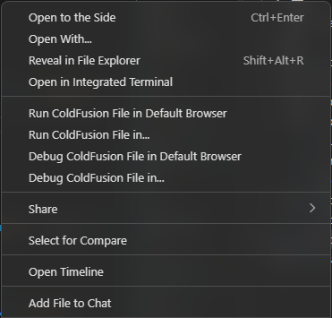
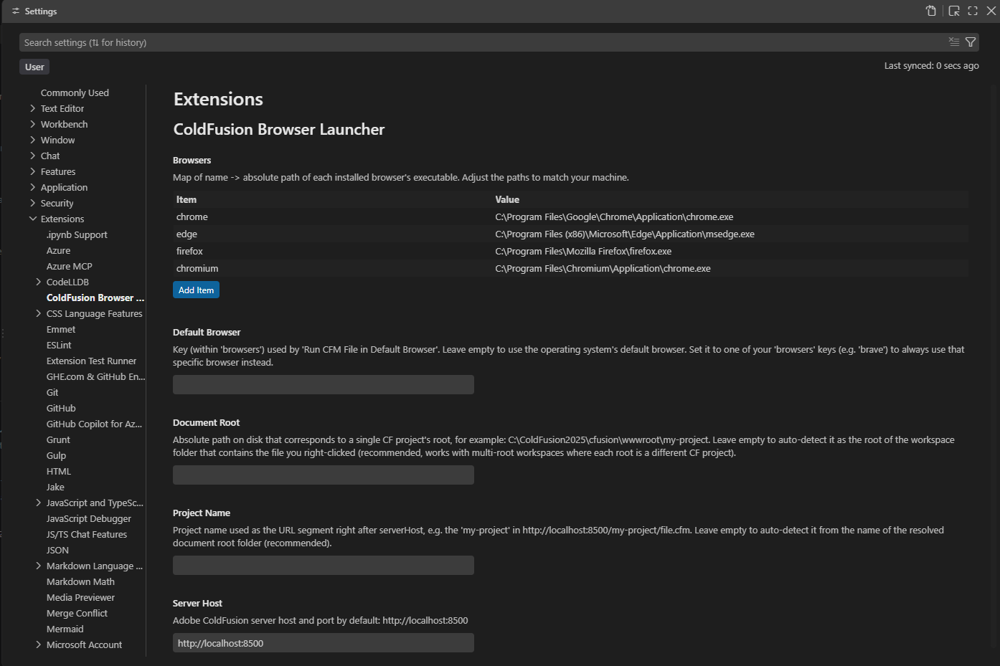

# ColdFusion Browser Launcher

[](LICENSE)
[](https://github.com/framecodeinc/cf-browser-launcher)
[](https://github.com/framecodeinc/cf-browser-launcher/issues)
[](https://github.com/framecodeinc/cf-browser-launcher/commits)

Run and debug ColdFusion files (`.cfm` and `.cfc`) against your local Adobe ColdFusion
server, in a browser of your choice — without touching your operating system's default browser.

This solves a specific gap in the Adobe ColdFusion Builder extension for VS Code:
both "Run As ColdFusion Application" and its debug command always open your OS default
browser, with no way to pick a different one. That's inconvenient if your main browser is
full of saved sessions, cookies, and passwords you don't want to clear constantly
during development.

## Features

Right-click any `.cfm` or `.cfc` file, in the Visual Studio Code Explorer panel or inside the
open editor, to get four options:

- **Run ColdFusion File in Default Browser** — instantly opens the file's URL. Uses your
  operating system's default browser out of the box; you can point it at a specific
  browser instead (see Configuration below).
- **Run ColdFusion File in...** — shows a picker to choose which configured browser to use,
  just for that one run.
- **Debug ColdFusion File in Default Browser** — starts a debug session for the file. Uses the
  same browser rule as the run option above.
- **Debug ColdFusion File in...** — starts a debug session and opens the page in the browser
  you pick, so VS Code stops at your breakpoints no matter which browser asked for the page.

The same four commands are available from the Command Palette (`Ctrl+Shift+P`, under
**CF Browser Launcher**) while a `.cfm` or `.cfc` file is the active editor. Two more palette-only
commands, **Show Log** and **Forget Remembered Projects**, are described under Commands below.

The extension automatically builds the correct URL for the file you clicked,
detecting which CF project it belongs to from your open workspace folder — no need
to type the URL by hand every time.

**Running** files is fully independent of the Adobe ColdFusion Builder extension and works
alongside it. **Debugging** uses Adobe's own debugger, so it needs that extension (see
Requirements).

## Usage

### Run a file

1. Make sure your ColdFusion server is running locally (e.g. `http://localhost:8500`).
2. Open your CF project folder in VS Code.
3. Right-click any `.cfm` or `.cfc` file → **Run ColdFusion File in Default Browser** or
   **Run ColdFusion File in...**.

### Debug a file

1. Install the **Adobe ColdFusion Builder** extension and enable debugging on your
   ColdFusion server, as described in Adobe's guide:
   [Debug applications | ColdFusion Builder](https://helpx.adobe.com/la/coldfusion/coldfusion-builder-extension-for-visual-studio-code/debug-applications.html).
2. Open your CF project in the workspace (the folder ColdFusion Builder created,
   which contains a `.vscode/<PROJECT>.cfproject` file).
3. Set a breakpoint in the `.cfm` file.
4. Right-click the file → **Debug ColdFusion File in...** and pick a browser.

The page opens in that browser and VS Code stops at the breakpoint.

 

#### Components (`.cfc`)

For a `.cfc` the extension does what Adobe's does: it opens the component's own URL. A component
isn't a page, so ColdFusion answers that request by redirecting to its component explorer
(`/CFIDE/componentutils/cfcexplorer.cfc`), which asks for your server's **RDS password** and then
shows the component's documentation, instead of running your methods. Breakpoints inside a component are only hit when something runs that code,
so to debug one, set the breakpoint in the `.cfc` and start the debug from the `.cfm` page that
uses it (or call a `remote` method through its URL).

#### How it works

Adobe's debugger always asks the operating system to open the page, and offers no setting
to change the browser. This extension starts that same debugger — Adobe's own debug
adapter, unmodified — and redirects only the "open the browser" step to the browser you chose.
It happens in memory while the session runs; no Adobe file is changed.

If the redirect can't be done (for example, after an Adobe update changes how the debugger
works), you get an error message instead of a silent failure, and the system default browser
may open instead.

On Linux there is one more problem in Adobe's debugger: it opens the page and waits for the
browser to be closed before it starts listening for breakpoints, so a breakpoint is only hit after
you close the browser. Both debug options avoid this: with a chosen browser it is started without
waiting, and with the system default browser the page is opened the same way but without the wait.

#### How the project is found

Like Adobe, the extension looks for `.vscode/*.cfproject` files in your workspace folders
and picks the project that contains the file (including its linked folders), so Adobe's
"select project" prompt doesn't appear. If a file belongs to a project that isn't open in
the workspace, Adobe asks once and the extension remembers the answer. Use
**CF Browser Launcher: Forget Remembered Projects** to clear what it remembered, for example
after moving a project to another server.

## Commands

The four run and debug options are in the right-click menu of `.cfm` and `.cfc` files, both in the
Explorer and inside the editor.
All the commands are also in the Command Palette: press `Ctrl+Shift+P` (`Cmd+Shift+P` on macOS) and
type `CF Browser Launcher`. The run and debug ones are listed while a `.cfm` or `.cfc` file is the
active editor; the two below are always available.

| Command | What it does |
|---|---|
| **CF Browser Launcher: Show Log** | Opens a short log of what the extension did: the file and browser used, the project found, whether the browser opened and any error. |
| **CF Browser Launcher: Forget Remembered Projects** | Clears the projects the extension remembered from earlier debug sessions. |

### Show Log

Opens the **ColdFusion Browser Launcher** panel in the Output view, with one line per event
(for example the file and browser you debugged with, the project that was detected, or an error).
It's the first place to look when a debug session doesn't behave as expected. The error messages
also have a **Show Log** button that opens it directly. It records nothing about your code.

### Forget Remembered Projects

When you debug a file whose project isn't open in your workspace, Adobe asks you to select the
project once, and the extension remembers your answer so it doesn't ask again. This command clears
what was remembered. Projects open in your workspace are unaffected, since those are detected from
their own files each time. Use it if remembered data went stale, for example after moving a project
to another server; Adobe will ask for the project again the next time it's needed. It doesn't change
your settings, your projects or your breakpoints.

## Extension Settings

Go to `Settings` (Ctrl+,) and search for `ColdFusion Browser Launcher`, or edit your
`settings.json` directly:



```jsonc
{
  "cfBrowserLauncher.serverHost": "http://localhost:8500",
  "cfBrowserLauncher.documentRoot": "", // empty = auto-detect from the workspace folder
  "cfBrowserLauncher.projectName": "", // empty = auto-detect from the folder name
  "cfBrowserLauncher.defaultBrowser": "", // empty = use the OS default browser
  // Only needed to add a browser or to change a built-in path (see "Built-in browsers")
  "cfBrowserLauncher.browsers": {
    "brave": "/usr/bin/brave-browser"
  }
}
```

| Setting | Default | Description |
|---|---|---|
| `serverHost` | `http://localhost:8500` | Your ColdFusion server's host and port, without the project name. Used by the run options; debugging uses the server configured in ColdFusion Builder. |
| `documentRoot` | *(empty)* | Absolute path to a specific CF project's root. Leave empty to auto-detect it from the workspace folder that contains the file you clicked. |
| `projectName` | *(empty)* | The URL segment right after `serverHost`. Leave empty to auto-detect it from the resolved document root's folder name. |
| `defaultBrowser` | *(empty)* | Which entry in `browsers` to use for "Run ColdFusion File in Default Browser" and "Debug ColdFusion File in Default Browser". Leave empty to use your OS default browser instead of a specific one. |
| `browsers` | *(empty; Chrome, Edge, Firefox and Chromium are built in)* | Extra browsers, or paths that replace a built-in one: map of browser name → absolute path to its executable. Add entries from the Settings UI (a table with an "Add Item" button), or edit `settings.json` directly. Changes apply right away. |

### Built-in browsers

The extension knows where these browsers are usually installed on each operating system, so you
don't need to configure them. The Settings screen only lists what you add. To use another browser,
or one installed elsewhere, add an entry to `browsers`; an entry with the same name as a built-in
one replaces its path.

| Name | Windows | macOS | Linux |
|---|---|---|---|
| `chrome` | `C:\Program Files\Google\Chrome\Application\chrome.exe` | `/Applications/Google Chrome.app/Contents/MacOS/Google Chrome` | `/usr/bin/google-chrome` |
| `edge` | `C:\Program Files (x86)\Microsoft\Edge\Application\msedge.exe` | `/Applications/Microsoft Edge.app/Contents/MacOS/Microsoft Edge` | `/usr/bin/microsoft-edge` |
| `firefox` | `C:\Program Files\Mozilla Firefox\firefox.exe` | `/Applications/Firefox.app/Contents/MacOS/firefox` | `/usr/bin/firefox` |
| `chromium` | `C:\Program Files\Chromium\Application\chrome.exe` | `/Applications/Chromium.app/Contents/MacOS/Chromium` | `/usr/bin/chromium` |

### About auto-detection (`documentRoot` and `projectName`)

This applies to the run options. By default (both left empty), the extension:

1. Finds the workspace folder that contains the `.cfm` file you right-clicked, and
   uses it as `documentRoot`.
2. Uses that folder's own name as `projectName`.
3. Builds the URL as `serverHost/projectName/relativePathToFile`.

This works out of the box whenever your local folder name matches the project name
your CF server uses (the common case), and it also works correctly in **multi-root
workspaces** — each root folder is resolved independently, so you can have several CF
projects open at once and each `.cfm` resolves to its own project's URL.

Override when needed:
- Set **`projectName`** if your local folder name doesn't match the URL segment the
  CF server expects (e.g. folder is `my-project-dev` but the server maps it as
  `myproject`).
- Set **`documentRoot`** if the actual CF project root is a *subfolder* of your open
  workspace, rather than the workspace root itself.

## Requirements

- A locally running Adobe ColdFusion server.
- The browser(s) you want to use already installed. Chrome, Edge, Firefox and Chromium are built in
  (see Built-in browsers); any other needs an entry in `browsers`.

To **debug** you also need:

- The [Adobe ColdFusion Builder extension](https://marketplace.visualstudio.com/search?term=ColdFusion%20Builder&target=VSCode)
  for VS Code installed. This extension was built and tested against version **1.0.880**.
- Debugging enabled on your ColdFusion server (see Adobe's guide linked above).
- Your CF project open in the workspace.

## Troubleshooting

Run **CF Browser Launcher: Show Log** from the Command Palette. It lists, one line per event,
the file and browser used, the project found, whether the browser opened, and any error.
Error messages also have a **Show Log** button.

- **"Another session has already set a breakpoint there"** — the ColdFusion server still has
  that breakpoint from another debug session. Stop every debug session and try again; if it
  persists, restarting the ColdFusion service may clear stale sessions.
- **The breakpoint is only hit after closing the browser (Linux)** — that is Adobe's debugger waiting
  for the browser to close. It doesn't happen with the debug options of this extension; if it does,
  open **Show Log** and check that it says the page was opened without waiting.
- **"the browser launch could not be redirected"** — the Adobe debugger is probably different
  from the version this extension was tested with. The log shows the installed version. The
  run options keep working; please open an issue.
- **Adobe asks you to select the project** — the file's project isn't in your workspace folders.
  Pick it once; the extension remembers it.

## Known Limitations

- Component (`.cfc`) debugging needs a page or remote call that runs the code (see above).
- Right-click menu labels are static — they can't show the file name or the selected
  browser's name (a VS Code platform limitation), only the run notification and the
  "Run ColdFusion File in..." picker do.
- URL building assumes the CF convention where the URL path mirrors the file's path
  on disk. It isn't meant for frameworks with client-side or code-based routing
  (Blazor, Angular, and similar).
- Assumes the standard single-webroot layout (`serverHost/projectName/...`). If your
  ColdFusion server uses **Virtual Host** settings (a project mapped to its own
  domain or port, with no project name in the URL), set `serverHost` to that
  project's full domain/port and `projectName` to whatever segment (if any) its URLs
  actually use — there's currently no way to omit the project segment entirely.
- The built-in browser paths for Linux were checked on Linux Mint 22.3; the ones for macOS are the usual
  install locations and have not been tested. Adjust them in `browsers` if yours are elsewhere.
  `serverHost` must start with `http://` or `https://`.
- Debugging in a browser of your choice relies on how Adobe's debugger opens the browser
  internally, so an Adobe update can break it (you'd get an error, see Troubleshooting).
  It has been tested on Windows 11 and Linux Mint 22.3, and not on macOS.
- The ColdFusion server rejects a breakpoint that another debug session already set on the same line.

## Author

FrameCode Inc.